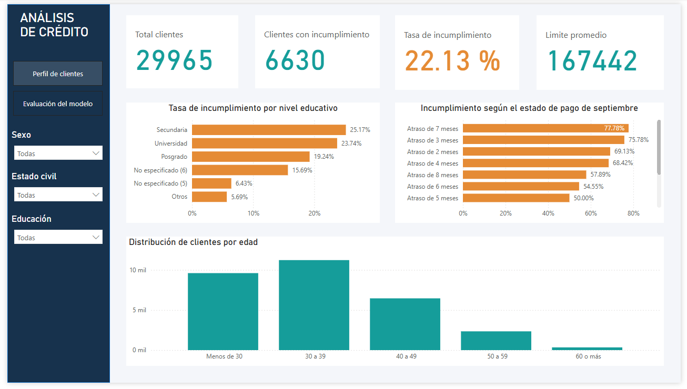

# 💳 Credit Default Risk Analysis

Proyecto de **Machine Learning y análisis de datos** orientado a predecir el incumplimiento de pago de clientes mediante modelos de clasificación supervisada y visualizar los principales resultados en un dashboard desarrollado en **Power BI**.

El proyecto incluye preparación y exploración de datos, comparación de modelos, optimización de un modelo Random Forest, selección de umbral de clasificación y preparación de archivos para su análisis en Power BI.

---

## 🎯 Objetivo del proyecto

Desarrollar un modelo de clasificación capaz de identificar clientes con mayor probabilidad de incumplimiento de pago y complementar el análisis predictivo con visualizaciones que faciliten la interpretación de los resultados.

---

## 🛠️ Tecnologías utilizadas

- Python
- Google Colab
- pandas
- NumPy
- scikit-learn
- Matplotlib
- Power BI
- Machine Learning supervisado

---

## 📊 Dataset

El dataset original contiene **30,000 registros** y **25 variables**, con información demográfica, límite de crédito, historial de pagos, montos facturados y pagos realizados.

Después del proceso de limpieza y preparación se trabajó con **29,965 clientes**.

La variable objetivo corresponde al **incumplimiento de pago del cliente**.

---

## 🔎 Etapas del proyecto

1. **Carga y revisión de datos**
   - Lectura del dataset.
   - Revisión de tipos de datos y estructura.
   - Validación de valores y variables.

2. **Data Quality & Cleaning**
   - Limpieza y preparación de los datos.
   - Tratamiento de variables categóricas y numéricas.
   - Validación de registros.

3. **Análisis Exploratorio de Datos (EDA)**
   - Análisis de variables demográficas.
   - Evaluación del historial de pagos.
   - Análisis de límites de crédito y montos facturados.
   - Revisión de la relación de las variables con el incumplimiento.

4. **Transformación de datos**
   - Separación de variables predictoras y variable objetivo.
   - Codificación de variables categóricas.
   - Escalamiento de variables cuando corresponde.
   - División en conjuntos de entrenamiento y prueba.

5. **Modelización**
   - Dummy Classifier como modelo de referencia.
   - Regresión Logística.
   - Árbol de Decisión.
   - Random Forest.
   - Gradient Boosting.

6. **Optimización**
   - Optimización de Random Forest mediante `RandomizedSearchCV`.
   - Validación cruzada estratificada de 5 particiones.
   - Evaluación de 20 combinaciones de hiperparámetros.
   - Selección del modelo utilizando **Average Precision (AP)**.

7. **Selección del umbral**
   - Evaluación de distintos umbrales de clasificación.
   - Selección de un umbral final de **0.53** buscando mejorar el equilibrio entre Precision, Recall y F1.

8. **Visualización en Power BI**
   - Preparación de archivos para análisis.
   - Creación de indicadores y visualizaciones.
   - Desarrollo de dashboard interactivo.

---

## 🤖 Modelo final

El modelo seleccionado fue un **Random Forest ajustado**.

Durante la optimización mediante validación cruzada, el modelo incrementó el **Recall de 35.78 % a 58.41 %** y el **F1 de 0.4667 a 0.5460**. La mejora permitió detectar una mayor proporción de clientes con incumplimiento, aunque también se observó una reducción en precisión y especificidad.

### Métricas sobre el conjunto de prueba

| Métrica | Resultado |
|---|---:|
| Accuracy | 79.19 % |
| Precision | 52.91 % |
| Recall | 54.22 % |
| F1-Score | 53.56 % |
| Especificidad | 86.29 % |
| ROC-AUC | 77.33 % |
| Average Precision | 54.92 % |
| Umbral de clasificación | 0.53 |

> El objetivo del proyecto no es afirmar que un único modelo sea superior en todos los escenarios, sino analizar el equilibrio entre detectar clientes con riesgo de incumplimiento y reducir falsos positivos.

---

## 📈 Dashboard en Power BI

El dashboard permite explorar el perfil de los clientes y analizar patrones asociados al incumplimiento de pago.

Entre los principales indicadores se encuentran:

- **29,965 clientes analizados**
- **6,630 clientes con incumplimiento**
- **22.13 % de tasa de incumplimiento**
- **167,442 de límite de crédito promedio**
- Tasa de incumplimiento por nivel educativo
- Incumplimiento según estado de pago
- Distribución de clientes por edad
- Filtros por sexo, estado civil y educación



---

## 📂 Estructura del repositorio

```text
credit-default-risk-analysis/
│
├── README.md
│
├── data/
│   ├── raw/
│   │   └── default_credit_card_clients.xls
│   └── processed/
│       ├── clients.csv
│       ├── model_comparison.csv
│       └── test_predictions.csv
│
├── images/
│   └── dashboard_overview.png
│
├── notebooks/
│   └── credit_default_classification.ipynb
│
└── power-bi/
    └── credit_default_dashboard.pbix
```

---

## 📁 Archivos generados para Power BI

El notebook genera tres archivos principales para alimentar el dashboard:

| Archivo | Descripción |
|---|---|
| `clients.csv` | Información procesada de los clientes y etiquetas descriptivas. |
| `test_predictions.csv` | Predicciones del conjunto de prueba, probabilidades y clasificación del resultado. |
| `model_comparison.csv` | Métricas utilizadas para comparar los modelos evaluados. |

---

## ▶️ Cómo ejecutar el proyecto

1. Abrir `notebooks/credit_default_classification.ipynb` en Google Colab o Jupyter Notebook.
2. Verificar la ruta del dataset dentro del notebook.
3. Ejecutar las celdas en orden para realizar la preparación, entrenamiento y evaluación de los modelos.
4. Generar los archivos procesados para Power BI.
5. Abrir `power-bi/credit_default_dashboard.pbix` para explorar el dashboard.

> Si el proyecto se ejecuta fuera de Google Colab, será necesario actualizar las rutas de lectura y exportación de archivos.

---

## 💡 Principales aprendizajes

Este proyecto permitió aplicar un flujo completo de análisis predictivo:

- Preparación y validación de datos.
- Análisis exploratorio.
- Construcción de pipelines de Machine Learning.
- Comparación de modelos de clasificación.
- Optimización de hiperparámetros.
- Evaluación mediante métricas adecuadas para clasificación.
- Ajuste del umbral de decisión.
- Integración de resultados de Machine Learning con Power BI.

---

## 👨‍💻 Autor

**Juan Tafur**

Bachiller en Ingeniería de Sistemas de Información.

Proyecto desarrollado como parte de mi portafolio profesional enfocado en **análisis de datos, Machine Learning, automatización y mejora de procesos**.
